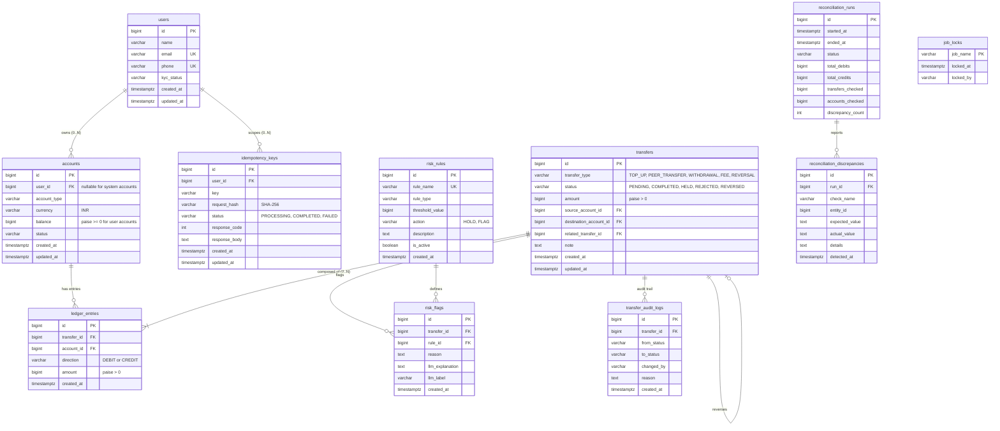

# Milestone 1: Database Schema & Financial Ledger Design

## 1. Requirement Noun Analysis

To design a clean relational schema, we extract every noun from the project brief and evaluate whether it possesses lifecycle state or additional attributes that warrant its own table:

| Noun in Requirements | Store Extra Info? | Resulting Table | Decision Rationale |
| :--- | :--- | :--- | :--- |
| **User** | Yes | `users` | Core business entity. Carries identity, KYC status, contact info, timestamps. |
| **Wallet / User Wallet** | Yes | `accounts` | Stores account type, currency (INR), stored balance, status, foreign key to user. Combined with system accounts into a single ledger account model. |
| **System Account** | Yes | `accounts` | Distinct accounts (Cash-in, Cash-out, Fee revenue) that participate as ledger counter-parties. Combined into `accounts` with `user_id = NULL`. |
| **Transfer** | Yes | `transfers` | The business event moving money (type, status, amount, source, destination, note, related reversal transfer). |
| **Ledger Entry** | Yes | `ledger_entries` | The atomic double-entry bookkeeping lines. Stores transfer ID, account ID, direction (`DEBIT`/`CREDIT`), amount, and timestamp. |
| **Idempotency Key** | Yes | `idempotency_keys` | Manages request deduping. Stores user ID, key UUID, request body SHA-256 hash, execution status, and cached response. |
| **Risk Rule** | Yes | `risk_rules` | Configurable fraud rules with dynamic thresholds and actions (`HOLD`, `FLAG`). |
| **Risk Flag** | Yes | `risk_flags` | Records violations detected per transfer, along with reason, LLM explanation, and label. |
| **Audit Log** | Yes | `transfer_audit_logs` | Immutable audit trail tracking every transfer status change, who initiated it, and why. |
| **Reconciliation Job** | Yes | `reconciliation_runs` & `reconciliation_discrepancies` | Records nightly audit execution details, balance totals, and exact discrepancy line items. |
| **Job Lock** | Yes | `job_locks` | Mutual exclusion lock row for concurrent job execution (`SELECT ... FOR UPDATE NOWAIT`). |
| **Currency** | No | Column in `accounts` | Only INR is supported per specification (`CHECK (currency = 'INR')`). No separate table needed. |
| **KYC Status** | No | Column in `users` | Simple state machine (`PENDING`, `VERIFIED`, `REJECTED`). Enforced via CHECK constraint. |
| **Rupee / Paise / Amount** | No | Column attribute | Stored as whole paise in `BIGINT` column across all financial tables. Never floating point. |
| **Statement** | No | Query / Projection | Virtual view computed dynamically from `ledger_entries` ordered by `created_at DESC, id DESC`. |

---

## 2. Cardinality Decisions

For each related pair of tables, we analyze the relationship from both directions:

1. **`users` ↔ `accounts` (1 : M)**
   - One user can hold multiple wallets (e.g. main wallet, savings wallet).
   - Each user wallet belongs to exactly one user.
   - *System accounts* have `user_id = NULL` (they belong to no user).
   - Placement: Foreign key `accounts.user_id` referencing `users(id)`.

2. **`transfers` ↔ `ledger_entries` (1 : M, M ≥ 2)**
   - One transfer generates at least two ledger entries (double-entry accounting principle: $\sum Debits = \sum Credits$).
   - Each ledger entry belongs to exactly one transfer.
   - Placement: Foreign key `ledger_entries.transfer_id` referencing `transfers(id)`.

3. **`accounts` ↔ `ledger_entries` (1 : M)**
   - One account has many ledger entries over time (its financial history).
   - Each ledger entry posts to exactly one account.
   - Placement: Foreign key `ledger_entries.account_id` referencing `accounts(id)`.

4. **`transfers` ↔ `transfers` (Reversals, 1 : 1 self-referencing)**
   - A reversal transfer points back to the original transfer it rectifies.
   - Placement: Self-referencing foreign key `transfers.related_transfer_id` referencing `transfers(id)`.

5. **`users` ↔ `idempotency_keys` (1 : M)**
   - A user submits multiple write requests over time, each carrying a client-chosen key.
   - An idempotency key belongs to one user.
   - Constraint: `UNIQUE (user_id, key)`.

6. **`transfers` ↔ `risk_flags` (1 : M)**
   - A single transfer can trip one or more risk rules.
   - Placement: Foreign key `risk_flags.transfer_id` referencing `transfers(id)`.

7. **`risk_rules` ↔ `risk_flags` (1 : M)**
   - A risk rule can be triggered across many transfers.
   - Placement: Foreign key `risk_flags.rule_id` referencing `risk_rules(id)`.

8. **`transfers` ↔ `transfer_audit_logs` (1 : M)**
   - A transfer changes status across its lifecycle (`PENDING` → `HELD` → `COMPLETED` or `REJECTED`).
   - Placement: Foreign key `transfer_audit_logs.transfer_id` referencing `transfers(id)`.

9. **`reconciliation_runs` ↔ `reconciliation_discrepancies` (1 : M)**
   - A single audit run can discover multiple discrepancies.
   - Placement: Foreign key `reconciliation_discrepancies.run_id` referencing `reconciliation_runs(id)`.

---

## 3. Entity-Relationship (ER) Diagram

---

## 4. Database-Level Protections & Invariants

Financial systems must enforce core safety rules at the **database engine level**, making invalid states structurally impossible regardless of bugs or race conditions in application code:

1. **Positive Ledger Amounts with Explicit Direction**
   - Stored in `ledger_entries` as `direction VARCHAR(6) CHECK (direction IN ('DEBIT', 'CREDIT'))` and `amount BIGINT CHECK (amount > 0)`.
   - *Why separate direction instead of signed amounts?*
     - Signed amounts introduce ambiguity: Does positive mean debit or credit? (In accounting, asset accounts increase on debit; liability accounts increase on credit).
     - Explicit separate columns prevent subtle minus-sign bugs during summation and query aggregation.
2. **User Balance Non-Negative Constraint**
   - `CONSTRAINT chk_user_wallet_non_negative CHECK (user_id IS NULL OR balance >= 0)`
   - Even if application locking had a flaw, Postgres will abort any transaction attempting to write `balance < 0` for any user wallet.
   - System accounts (like cash-in or fee revenue) have `user_id = NULL` and can represent platform liquidity without restriction.
3. **Immutability of Ledger Entries**
   - Enforced via a PostgreSQL `BEFORE UPDATE OR DELETE` trigger `trg_no_update_delete_ledger_entries`.
   - Any manual or programmatic `UPDATE` or `DELETE` attempt on `ledger_entries` throws a fatal SQL exception. Corrections must always be made via new reversal transfers.
4. **Idempotency Scope Constraint**
   - `CONSTRAINT uq_idempotency_user_key UNIQUE (user_id, key)`
   - Guarantees that concurrent requests for the same user and key collide on the unique index at the database level, preventing double-execution.

---

## 5. Architectural Design Answers

### Q1: Do you store each account's balance, compute it from ledger entries, or both? What does each option cost you?
**Decision: Both (Stored Balance + Ledger Verification).**
- **Why store `accounts.balance`:** High-concurrency payment processing requires $O(1)$ fast balance checks and atomic row updates (`SELECT balance FROM accounts WHERE id = ? FOR UPDATE`). Computing balance on-the-fly would require `SELECT SUM(CASE WHEN direction = 'CREDIT' THEN amount ELSE -amount END) FROM ledger_entries WHERE account_id = ?`, which scans every historical transaction for that wallet. As a ledger grows to millions of entries, transfer latency degrades to $O(N)$ table scans and causes lock contention.
- **Why keep immutable `ledger_entries`:** The ledger entries represent the single source of financial truth and legal auditability. Stored balances are a materialized acceleration column.
- **The Cost:** Every transfer must atomically write `ledger_entries` and update `accounts.balance` inside the same database transaction. Any desynchronization is a critical integrity fault, which is why our Milestone 4 Nightly Reconciliation job systematically verifies that every stored balance exactly equals its computed ledger sum.

### Q2: Why store user wallets and system accounts in the same table?
- **Unified Relational Integrity:** In double-entry accounting, money flows from one account to another regardless of whether the counterparty is a peer user, a payment gateway cash-in account, or a fee revenue bucket.
- If system accounts were in a separate table, foreign keys in `ledger_entries` and `transfers` would require polymorphic keys (e.g. `account_type` + `account_id`) or messy nullable dual foreign keys (`user_account_id`, `system_account_id`). This would break standard relational foreign key cascading, complicate indexing, and destroy query simplicity.
- By using a single `accounts` table with a nullable `user_id`, we get clean referential integrity, unified row-level locking (`SELECT ... FOR UPDATE ORDER BY id ASC`), and clean balance constraints (`user_id IS NULL OR balance >= 0`).

### Q3: Which columns hold data you don't control, such as phone or email? Why is none of them a primary key?
- Columns: `users.phone` and `users.email`.
- **Reasons why they must NEVER be primary keys:**
  1. **Mutability:** Users change email addresses and mobile numbers (e.g. lost SIM cards, carrier changes, corporate domain migrations). Primary key updates trigger heavy cascading updates across all child foreign-key tables.
  2. **Recycling / Reassignment:** Telecom operators reassign disconnected mobile numbers to new subscribers after 90 days. If phone were a primary key, a new user would inherit historical financial account references.
  3. **Performance & Storage:** Surrogate `BIGINT` keys (64-bit integers) are fixed at 8 bytes, sequential, and create optimal B-tree index node layouts. Variable-length strings (emails/phones) bloat index sizes and degrade cache efficiency.
  4. **Privacy / PII Leakage:** Exposing primary keys in API routes (e.g. `/users/42/wallets`) is safe, whereas exposing raw emails or phone numbers in logs or URLs leaks sensitive personal information.
